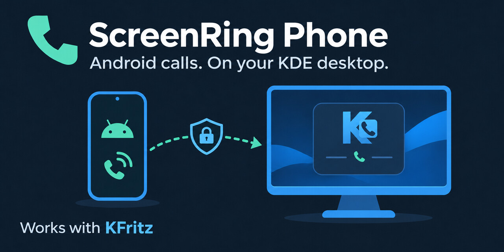
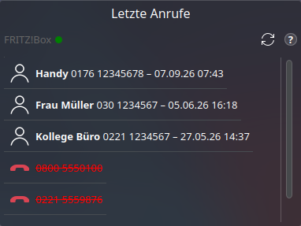

<div align="center">
  
  <h1>ScreenRing Phone</h1>
  <p><strong>Your Android rings. KFritz lets your desktop know.</strong></p>
  <p>Incoming-call alerts on KDE Plasma, over your local network.</p>
  <p>
    <a href="https://github.com/Agundur-KDE/ScreenRing-Phone/releases/download/v0.6.0-alpha.2/ScreenRing-Phone-0.6.0-alpha.2.apk"></a>
    <a href="https://github.com/Agundur-KDE/kfritz/releases/tag/v0.5.0"></a>
  </p>
  <p><a href="INSTALL.de.md">Deutsche Anleitung</a> · <a href="#pair-your-phone-in-a-minute">Setup</a> · <a href="PRIVACY.md">Privacy</a> · <a href="https://github.com/Agundur-KDE/ScreenRing-Phone/issues">Help & feedback</a></p>
</div>

## A companion for KFritz

**ScreenRing Phone connects your Android phone to [KFritz](https://github.com/Agundur-KDE/kfritz),
the KDE Plasma desktop call monitor.** See incoming cellular calls on your Linux
desktop, with optional caller name and number. The phone sends call events —
**never the conversation audio**.

No developer account, advertising or analytics SDK. Your phone and computer
communicate directly on your local network. Caller details are encrypted for
the receivers you pair.

| On your Android phone | On your Linux desktop |
| --- | --- |
| ScreenRing Phone detects an incoming cellular call. | KFritz receives the alert and shows its notification or call overlay. |
| Optional permissions resolve the incoming number and local contact name. | KFritz can show caller details and apply its configured blocklists. |
| Start forwarding once and keep the foreground service running. | Keep the computer awake and reachable on your home network. |

<p align="center">
  
  <br><em>The KFritz desktop interface. Existing project screenshot; this is not a capture of the new phone-pairing screen.</em>
</p>

## Download both parts

1. **Desktop:** install **[KFritz 0.5.0 or newer](https://github.com/Agundur-KDE/kfritz/releases/tag/v0.5.0)** for KDE Plasma.
2. **Phone:** download the signed **[ScreenRing Phone APK](https://github.com/Agundur-KDE/ScreenRing-Phone/releases/download/v0.6.0-alpha.2/ScreenRing-Phone-0.6.0-alpha.2.apk)**. Get `SHA256SUMS` and `SIGNER.txt` from [the same release](https://github.com/Agundur-KDE/ScreenRing-Phone/releases/tag/v0.6.0-alpha.2).

> **Compatibility:** KFritz 0.4.1 and earlier do not have the ScreenRing mobile
> receiver. The Android companion is currently an **alpha**, intended for testing;
> this is not a promise of reliable operation on every phone or network.

**Available downloads:** ScreenRing Phone **0.6.0-alpha.2** and KFritz **0.5.0**,
with matching protocol support. Use the two releases linked above.

**Requirements:** Android 8+, a phone with cellular calling, KDE Plasma with a
compatible KFritz installation, and a local network that allows the devices to
reach each other. A FRITZ!Box is not needed to transport the phone alert; KFritz's
direct FRITZ!Box landline functions are separate.

## Pair your phone in a minute

1. In KFritz, open **Settings → Mobile calls**, enable reception, generate a
   pairing key and **save**.
2. In ScreenRing Phone, enable the **KFritz/desktop destination**. Enter the
   computer's local IP address, receiver port (**10123** by default), and key.
3. Allow **phone-state** access. Turn on caller details only if you want to grant
   the optional number/contact permissions.
4. **Start forwarding**, then **send a test**. A test shows a connection alert;
   it does not pause playback or make a phone call.

If the connection fails, check that KFritz is running and mobile reception is
on. Guest Wi-Fi/client isolation or a desktop firewall can block the connection;
allow the configured TCP port only on your trusted home-network zone.

Keep the pairing key private. Replacing it in KFritz disconnects previously
paired phones until you update their settings.

## Verify the APK

On Linux, put the APK and `SHA256SUMS` in the same folder and run:

```sh
sha256sum -c SHA256SUMS
```

The permanent phone signing-certificate SHA-256 is:

```text
e126db475859e63617676ac0030acb3ee3b87242779b26cdced241f1a7405d86
```

It must match the APK signing certificate and `SIGNER.txt`. With Android SDK
build-tools installed, `apksigner verify --print-certs <downloaded.apk>` displays
that certificate fingerprint. A checksum downloaded alongside an APK detects
corruption; it does not independently prove the publisher's identity.

Android will ask you to permit installation from your browser or file manager.
You can disable that permission again afterward. Existing debug/development
builds use another signature and cannot be updated in place. **Uninstalling
deletes settings and pairing information**; plan that transition first.

## What to expect

- Incoming cellular calls: ringing, answer and end events; no outgoing-call alerts.
- Optional caller details; generic alerts work without number/contact access.
- Background forwarding with an ongoing notification. Unlock once after reboot.
  Force-stop and manufacturer power-saving rules may require opening and starting
  the app again.
- Device/call identifiers and event types are visible in the protocol header;
  caller name, number and phone label are encrypted. See [privacy and permissions](PRIVACY.md).
- No call answering/hang-up controls, conversation recording or WhatsApp/VoIP promise.

### And Google TV?

The app also supports a separately paired **ScreenRing TV** receiver. That is a
separate app planned for Google Play, and is not included here. **KFritz is the
desktop receiver, not a required relay for phone-to-TV delivery.** This repository
focuses on the publicly available KFritz desktop setup.

## Feedback and project information

Report reproducible problems in [Issues](https://github.com/Agundur-KDE/ScreenRing-Phone/issues).
Include app/KFritz version, Android version and the error state — **no real
caller data, pairing keys, phonebooks or unredacted logs**.

This is a binary-download and documentation repository. The Android application
source and the TV application are not published here. No open-source licence for
the Android binary is granted by this repository. KFritz is a separate
[GPL-3.0-or-later project](https://github.com/Agundur-KDE/kfritz/blob/main/LICENSE).

[Release notes](CHANGELOG.md) · [Privacy](PRIVACY.md) · [Artwork and screenshot credits](ASSETS.md)
